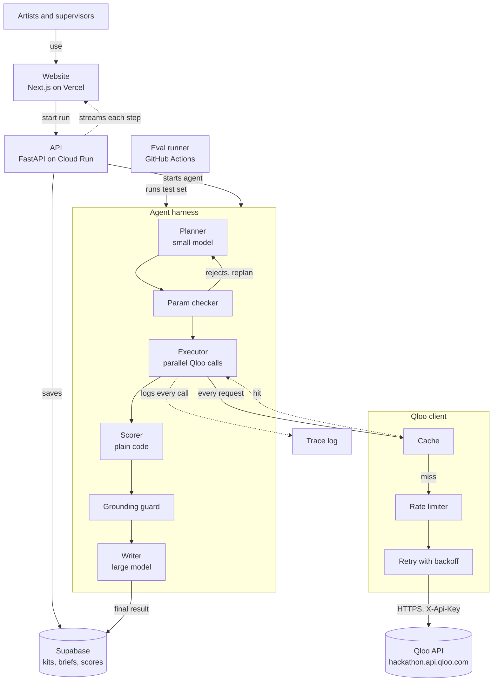
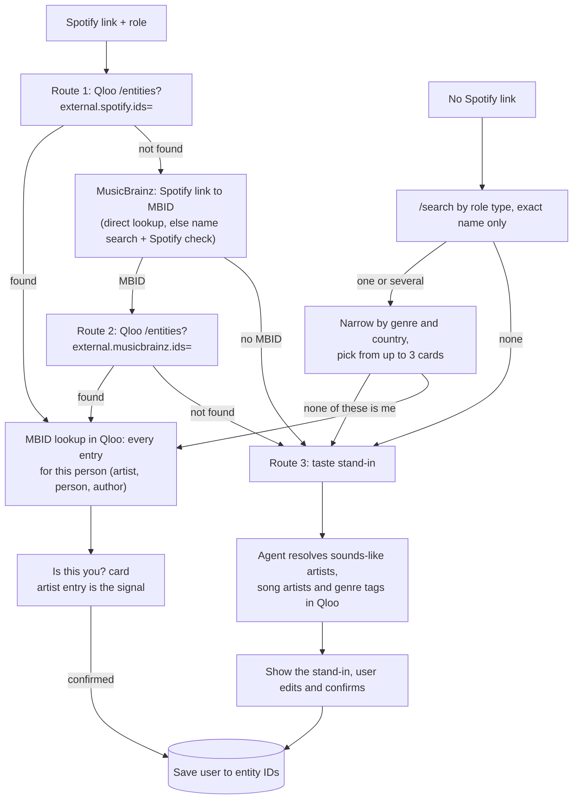
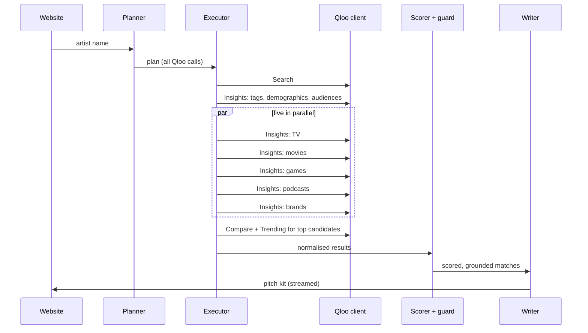

# Cue — Design

How Cue is built and why. Requirements live in [PRD.md](PRD.md); rules every session must follow
live in [CLAUDE.md](CLAUDE.md).

## 1. System



The LLM plans and writes. Qloo supplies the facts. Plain code checks and scores. Every Qloo request
goes through one client, and only a cache miss reaches the API.

## 2. One run, both modes

| Step | Artist mode | Supervisor mode | Qloo endpoints |
|---|---|---|---|
| 1 Find | Onboarding (§2.1): Spotify ID, then name search, then a taste stand-in | Find the show, film, game or brand | Entities by external ID, Search, Tags |
| 2 Profile | Fan taste tags, age and gender lean, audiences | Audience taste tags, age and gender lean, audiences | Insights (tags), Tags, Tag types, Audiences, Audience types |
| 3 Match | Insights for TV, movies, games, podcasts, brands, in parallel | Insights for artists with `filter.popularity.max` | Insights |
| 4 Check | Compare artist vs each top production; trending shows | Compare production vs each top artist; trending artists | Compare, Trending |
| 5 Score and write | Fit score in code; pitch kit per production | Same fit score; shortlist brief | — |
| Extra | Which neighbourhoods of a chosen city the fans cluster in, for gigs and local ads | Same, for the show's audience | Insights (heatmap) |

### 2.1 Artist onboarding



- **Exact name match** means the normalised name equals the query (case, accents and spacing
  ignored). Search's first hit is never taken on its own.
- **Search type by role:** singers, bands, composers and producers search `urn:entity:artist`;
  lyricists search `urn:entity:person`, then `urn:entity:author`.
- **MusicBrainz** has two jobs, both in `cue/identity/musicbrainz.py`, outside the Qloo client:
  turning a Spotify link into an MBID (`find_mbid_by_spotify`, onboarding), and checking whether a
  shortlisted artist has died or disbanded (`life_span`, supervisor mode). One shared client
  allows 1 request per second across the whole app, sends a descriptive `User-Agent`, caches for
  30 days and makes no call in `DEMO_MODE`. Any failure means "unknown", never "ended". Taste data
  always comes from Qloo.
- **Route 3 signals:** sounds-like and song artists go in `signal.interests.entities`, genre tags in
  `signal.interests.tags`. Explainability then says which input drove each match.
- **Saved link:** the confirmed user-to-entity mapping lives in Supabase. It holds Qloo IDs we chose,
  not Qloo response data.
- **Honesty:** results from a stand-in say "based on artists you resemble".



## 3. Using Qloo

**Base URL:** `https://hackathon.api.qloo.com`. Hackathon keys fail against staging and production
with a 401. Key goes in the `X-Api-Key` header. Insights is a GET with parameters in the query
string.

**Entity types for `filter.type`:** artist, book, brand, locality, movie, person, place, podcast,
tv_show, videogame (as `urn:entity:<type>`). Music is `urn:entity:artist`. Games are
`urn:entity:videogame`; `urn:entity:video_game` returns a 400. The hackathon guide also lists
`destination`; it is untested, and the API reference uses `locality`.

Special `filter.type` values on `/v2/insights`: `urn:demographics` (age and gender lean),
`urn:heatmap` (where an audience clusters) and `urn:tag` (taste tags for an audience).

**Endpoints we use** (all checked against the live API on 21 Oct 2026):

| Endpoint | Our tool | Used for |
|---|---|---|
| `/search` | `find_entity` | Name to Qloo ID; grounding guard; made-up-name check in eval |
| `/entities?entity_ids=` | `get_entities` | Details for the report; ID check in the guard |
| `/v2/tags?filter.query=` | `find_tags` | Words like "dream pop" to tag IDs |
| `/v2/tags/types` | `get_tag_types` | Grouping the taste profile |
| `/v2/audiences?filter.query=` | `find_audiences` | Audience groups for the profile and as signals |
| `/v2/audiences/types` | `get_audience_types` | Listing audience kinds |
| `/v2/insights` | `insights` | Profiles, matches, demographics, heatmap |
| `/v2/analysis/compare` | `compare` | Artist vs production fit |
| `/v2/trending` | `trending` | Whether a candidate is rising |

Don't use `/recommendations` or `/recs`; they are legacy and unsupported.

**Parameters we lean on:**

- Signals: `signal.interests.entities`, `signal.interests.tags`, `signal.demographics.age`,
  `signal.demographics.gender`, `signal.demographics.audiences`, `bias.trends`
- Filters: `filter.type`, `filter.popularity.max`, `filter.results.entities`,
  `filter.exclude.entities`, `filter.tags`, `filter.release_year.min` (movies),
  `filter.latest_known_year.min` (TV, keeps results to shows still running)
- Output: `feature.explainability`, `take` (max 50), `page`, `sort_by`, `diversify.by`,
  `output.heatmap.boundary`

**Quirk that shapes the design:** invalid parameters for a `filter.type` are silently ignored.
A request can look fine and return the wrong thing. That is why the param checker exists (§4).

### What the live API actually returns

Checked on 21 Oct 2026 with real calls. Build WU-01 against these, not against the doc prose.

- **Entity shape.** `types` is a list (read `types[0]`). `popularity` is top level, 0–1. On
  Insights results, `affinity` is at `query.affinity` and the explanation at
  `query.explainability`.
- **Explainability.** `query.explainability["signal.interests.entities"]` is a list of
  `{entity_id, score}`, one per input entity. With three sounds-like artists as the signal, each
  gets its own share, so every match can say which input drove it.
- **Extra artist data.** `properties.external` carries `lastfm.listeners` and `lastfm.scrobbles`
  (real fan counts), plus Spotify, MusicBrainz and Wikidata IDs. Artist tags include audience
  traits such as `urn:tag:audience:qloo:loyal` and `:passionate`.
- **Search returns wrong top hits.** When the exact name isn't in Qloo, `/search` still returns
  its nearest fuzzy match first ("Aditi Ramesh" → "Ramesh"). `find_entity` must check the name
  matches and return not found otherwise, never take the first hit blindly.
- **Artists also exist as people.** Prateek Kuhad comes back twice: a `urn:entity:person` entry
  with no Spotify ID, and the `urn:entity:artist` entry with Spotify, MusicBrainz and Wikidata IDs.
  Both share one MusicBrainz ID. Signalling with the person entry gives different matches and an
  empty demographics result. Always pass `types=urn:entity:artist` to `/search` for artists.
- **Spotify lookup is exact.** `/entities?external.spotify.ids=<id>` returned the single artist
  entry. This is Route 1 of onboarding (§2.1).
- **MBID lookup returns every entry for one person.** `/entities?external.musicbrainz.ids=<mbid>`
  returned Prateek Kuhad's artist and person entries together. This is how we merge duplicates.
- **Lyricists are usually person entries only.** Amitabh Bhattacharya, Swanand Kirkire and Irshad
  Kamil have `urn:entity:person` (sometimes `author`) entries with no Spotify ID, but their entries
  carry the MBID, so Route 2 finds all three. Composers who release music (Amit Trivedi, Vishal
  Bhardwaj, Gulzar) have artist entries with Spotify IDs. Person-entry signals gave weaker results
  for Prateek, so test a lyricist end to end before demoing one.
- **Names collide.** A name search for "Divine" matched an artist whose top TV shows were all
  British crime dramas, not the Mumbai rapper. Name-only onboarding needs the confirm card.
- **No music credits on shows.** TV and film entries carry genres, cast-free descriptions, tags
  and review links, but no composer, music director or lyricist. Qloo can't tell us who made a
  show's music.
- **Games skew to blockbusters.** Without a cap, game affinities return the most popular titles
  for almost any artist. Use `filter.popularity.max` (about 0.9) for games.
- **Duplicate titles.** The same title can appear twice with different entity IDs (seasons or
  versions). De-duplicate by normalised title and keep every ID for the grounding guard.
- **Compare** takes `a.signal.interests.entities` and `b.signal.interests.entities` and returns
  `results.tags` (shared tags, each with `query.score`), plus `results.a` and `results.b` (each
  side's own tags). **Between an artist and a TV show, the shared list came back empty**: music tags
  and TV tags rarely overlap. See PRD Q-7.
- **Compare works between artists, but doesn't separate shows.** Prateek Kuhad vs other artists
  shared 40+ tags. But each show's favourite artists were the same famous names, so "does his sound
  match the show's favourite artists?" scored 0.63–0.65 for every show we tried, even with
  `filter.popularity.max` 0.85 on the show's artists. Keep artist-vs-artist Compare for checking
  sounds-like artists in Route 3.
- **Affinity barely varies.** For Prateek Kuhad, the top five TV shows scored 0.945–0.956. Rank
  order carries more information than the raw number. See PRD Q-7.
- **Popular shows top everyone's list.** *Aarya* and *Criminal Justice* are in the top TV matches
  for Prateek Kuhad, Anuv Jain, Ritviz and Arijit Singh alike. Raw Insights results reflect what
  Indian streaming audiences watch, not what one artist's fans specifically watch. See PRD Q-7.
- **Reverse affinity works.** Insights with the show as the signal and
  `filter.results.entities=<artist>` gives "how much do this show's fans like this artist": 0.909
  to 0.918 for Prateek Kuhad across three shows. One call per show.
- **Fan taste tags are noisy.** `filter.type=urn:tag` with an artist as the signal returned place
  and brand tags first (VISA, Mocktails, Five Star, Expensive). Use the artist entry's own `tags`
  (43 clean music, mood, theme and audience tags for Prateek Kuhad), or restrict tag types.
- **Trending is per entity, not a list.** `/v2/trending` requires `signal.interests.entities`,
  `filter.start_date` and `filter.end_date`, and returns a weekly series for that entity
  (`population_percentile`, `population_rank`, `population_rank_velocity`,
  `velocity_fold_change`). **The hackathon data ends around 30 Jul 2026**, so a window ending after
  that comes back empty. Query the 12 weeks up to the latest available week. The `trending` tool
  in §7.1 takes one entity and returns this series with its as-of date. **For an artist it came
  back empty** (Prateek Kuhad, May to July 2026) while a TV show returned 13 weeks. Until we find
  artist data, `trend` may only be available for productions. Check the week order too: the newest
  week may come first.
- **Demographics** returns `results.demographics[0].query.age` (six buckets, `24_and_younger` to
  `55_and_older`) and `.gender` (`male`, `female`), each from −1 to 1.
- **Heatmap** returns `results.heatmap[]`, each with `location` (lat, lon, geohash) and `query`
  (`affinity`, `affinity_rank`, `popularity`). It **needs an area**: without `filter.location` or
  `filter.location.query` it returns a 400. Only the default `urn:geohash` boundary returned data:
  `urn:entity:locality` gave 0 results for both India and Mumbai, and `city` is a 400. Inside
  Mumbai, Prateek Kuhad's heatmap returned 2,951 squares of a few city blocks each, with the top
  ones tied at 0.997 affinity. So it maps neighbourhoods within one city (Worli, Lower Parel,
  Bandra); it can't rank cities without one call per city.
- **Explainability with one input is trivial.** With a single signal entity it only says "100%
  from this entity". It becomes useful with several inputs, as in Route 3.

## 4. Harness

- **Planner** (Claude Haiku 5.5, effort `low`, structured output, `cue/agents/planner/`): makes
  **decisions**, and code turns them into calls. It picks production types, popularity sections,
  up to 3 brief phrases to look up as tags, and whether to use lift, each from a fixed list in the
  output schema, plus a one-line note shown in the trace. Code builds the calls (profile,
  comparison group, one Insights call per type and section), so parameters are always valid.
  **Round 2:** the planner sees a short summary of round 1's results (counts per type and section)
  and may add types or sections that came back thin, or stop. At most 2 rounds. If the model
  fails or the budget is spent, a default plan runs instead. Brief tags are only used for a
  production type when they come from its own vocabulary (`genre:media`/`keyword:media`, or
  `genre:brand`), never music tags
- **Model calls** go through `cue/agents/common/llm.py` only: structured output, a cache keyed by
  model, `PROMPT_VERSION` and input (free on repeat, required in `DEMO_MODE`), and a spend ledger
  that refuses any call whose worst-case cost would pass `LLM_BUDGET_USD`
- **Param checker** (`cue/qloo/params.py`): a table of which parameters each `filter.type` accepts,
  copied from Qloo's Entity Type Parameter Guide. Any call with an unsupported parameter is rejected
  and sent back to the planner with the reason. Max two replans.
- **Executor:** runs calls as `asyncio` tasks in dependency order; independent calls run in
  parallel. Per-call timeout 20 s (it includes time waiting for the rate limiter). Max 40 Qloo calls per run.
- **Scorer:** see §6.
- **Grounding guard:** see §5.
- **Writer** (`cue/agents/writer/`, `LLM_LARGE_MODEL`; Haiku 5.5 during development): sees each
  pick under a short alias (`{{S-1}}`), and the output schema only allows those aliases, so it can't
  name a production it wasn't given. It gets the brief, plain facts per pick and style rules (no
  jargon, vary each email, call a film a film). Code maps aliases back to Qloo IDs, attaches the
  scores and runs the guards. Turns scored, grounded matches into a pitch kit or
  brief. Gets only our checked data, never raw text from elsewhere.
- **Run events:** every step and Qloo call emits an event (§7.3), streamed to the website over
  server-sent events and stored with the run.

## 5. Guardrails and caching

**Guardrails**

| Guard | Where | What it stops |
|---|---|---|
| Param checker | Before every Qloo call | Requests Qloo would silently ignore |
| Grounding guard | After the writer | Any name not matching a Qloo ID from this run |
| Pitch-claim guard | After the writer | "Your song was featured in…" without data showing it |
| Score lock | Writer output schema | The model can't output a score; scores are joined in by code |
| Input handling | Planner and writer | Artist names and briefs are data in a delimited field, never instructions |
| Popularity cap | Supervisor mode | Famous artists on an under-the-radar shortlist |

**Caching** (private, server-side only; Qloo allows this with no time limit)

| What | Key | Keep for |
|---|---|---|
| Name to Qloo ID | normalised name + type | 30 days |
| Qloo responses | endpoint + sorted, normalised params | 24 hours |
| Planner output | input + `PROMPT_VERSION` | 24 hours |
| Writer output | scored matches hash + `PROMPT_VERSION` | 24 hours |

Never cache fit scores; recompute them from cached inputs so a scorer change takes effect at once.
Start with an in-memory cache behind the `Cache` interface; switch to Redis (Upstash) for deploy.

**Rate limiting and retries:** token bucket in the Qloo client sized below our key's limit; retry
429 and 5xx up to 3 times with jittered backoff; a 4xx other than 429 is not retried.

**Speed**

- Plan once, run in parallel
- Small model for planning, large model only for writing
- Stream results as they arrive
- Provider-side prompt caching for the fixed instructions and tool definitions
- Pre-warm the demo artists and shows before judging

## 6. Fit score

Plain code in `cue/scoring/`. Decided 24 Oct 2026 (PRD Q-7): **lift, inside three popularity
sections.**

**Sections.** A production's own popularity puts it in a section. Each section is its own Insights
call with `filter.popularity.min/max`, so smaller productions always reach the results instead of
being crowded out by the famous ones.

| Section | Popularity | Meaning for the artist |
|---|---|---|
| `big_screen` | ≥ 0.90 | Famous; a long shot |
| `prime_time` | 0.70 – 0.90 | Mid-size; realistic |
| `indie_gems` | < 0.70 | Smaller; the best chance |

**Lift** is the main signal: how much more *this* artist's fans like a production than fans of
similar artists do. Raw affinity is nearly flat, and the same popular shows top every Indian
artist's list; lift removes those. Live check (24 Oct, Prateek Kuhad, TV): *Panchayat*,
*Delhi Crime* and *Kota Factory* (lift ≈ 0) drop out; *Masaba Masaba*, *Decoupled* and *Ray* rise;
crime thrillers (*Mirzapur*, *Breathe*) fall to the bottom.

```
lift(p)     = affinity of the artist's fans for p − affinity of the comparison group for p
group       = one Insights call signalled with the 4 artists Qloo finds most similar to the artist
              (for a stand-in profile: similar to its sounds-like artists), per production type
missing p in the group's results → the group's lowest affinity in that call
```

Inside each section, rank by **match**:

```
lift_rank = position by lift within the section, rescaled to 0–1 (best 1, worst 0; ties share a rank)
audience  = 1 − mean absolute difference between the two age and gender leans, scaled to 0–1
match     = 0.70 × lift_rank + 0.30 × audience
```

- `audience` missing → `match = lift_rank` (its weight is shared, never counted as 0)
- No lift possible (no comparison group, or the production has no affinity) → `insufficient_data`
- A section with one production gives it `lift_rank = 1`
- `lift`, `lift_rank`, `audience` and `section` go in `FitScore.inputs`; `Match.overlap` stays
  `None`. No contract change
- Weights are a starting point, tuned only on the eval's dev split, never on the test split
- **Dropped:** Compare's shared tags (empty between an artist and a production), reverse affinity
  (flat, 0.91–0.94 for every show) and **trend** (PRD Q-9: Qloo's trending data stopped changing
  around Dec 2025, so it can't say what is rising)

## 7. The agreed contract

Changing anything here is a MAJOR change: agree in chat first, own PR, VERSION.md entry.

### 7.1 Qloo tools

```python
async def find_entity(name: str, types: list[str]) -> list[EntityRef]
async def get_entities(ids: list[str]) -> list[Entity]
async def find_tags(query: str, tag_types: list[str] | None = None) -> list[TagRef]
async def get_tag_types() -> list[str]
async def find_audiences(query: str | None = None, audience_types: list[str] | None = None) -> list[AudienceRef]
async def get_audience_types() -> list[str]
async def insights(request: InsightsRequest) -> InsightsResult
async def compare(a_ids: list[str], b_ids: list[str]) -> CompareResult
async def trending(entity_id: str, entity_type: str) -> TrendSeries
```

### 7.2 Records

```python
EntityRef      id, name, type, popularity
Match          source_id, candidate: EntityRef, affinity, overlap, audience, trend, trend_as_of: date | None, explanation
TrendSeries    entity_id, as_of: date | None, weeks: list[TrendWeek]
TrendWeek      week_start: date, percentile, rank, rank_velocity, velocity_fold_change
FitScore       match_id, value: float | None, status: "ok" | "insufficient_data", inputs: dict
PitchKit       run_id, artist_id, items: list[PitchItem]
PitchItem      candidate: EntityRef, fit: FitScore, reason: str, email_subject: str, email_body: str
Brief          run_id, production_id, artists: list[BriefItem]
BriefItem      candidate: EntityRef, fit: FitScore, reason: str
```

### 7.3 Run events (streamed to the website)

```json
{"run_id": "r_123", "seq": 7, "kind": "qloo_call", "endpoint": "/v2/insights",
 "params": {"filter.type": "urn:entity:tv_show", "signal.interests.entities": "..."},
 "ms": 412, "cache": "miss", "status": "ok", "result_count": 20}
```

`kind` is one of `step_start`, `step_end`, `qloo_call`, `guard_drop`, `result`, `error`.

### 7.4 Eval record

```json
{"id": "p_042", "split": "test", "mode": "supervisor", "input": "Show name",
 "answer": "Artist name", "source": "where we learned this placement"}
```

No Qloo responses in eval files. Ever.

## 8. Evaluation

**Systems:** A = LLM alone, B = LLM with web search, C = Cue. Same test set, same scorers.

**Test set:** about 300 known real placements (artist used in show), split 60 dev / 240 test.
Curated by hand or from sources whose terms allow it (PRD Q-4).

**Scorers**

| Metric | How |
|---|---|
| Hit rate in top 10 | Is the known answer in the system's top 10? Both directions |
| Made-up names | Share of suggested names that don't resolve via Qloo Search |
| Under-the-radar share | Share of suggested artists under the popularity cap |
| Consistency | Overlap of top 10 across three runs of the same input |
| Time and cost | Per run, median and slowest |

**Runs:** a 30-sample smoke eval on every push (GitHub Actions); the full set on demand. Results
feed the eval page as JSON with our scores only.

## 9. Deployment and observability

- Website on Vercel; API on Cloud Run (stateless, min 1 instance during judging so there's no cold
  start); Supabase for storage; Upstash Redis for cache
- Secrets in Secret Manager; `.env` locally
- Every run stores its events; the trace panel reads them live
- `DEMO_MODE=true` serves every Qloo and model call from cache with zero external calls
