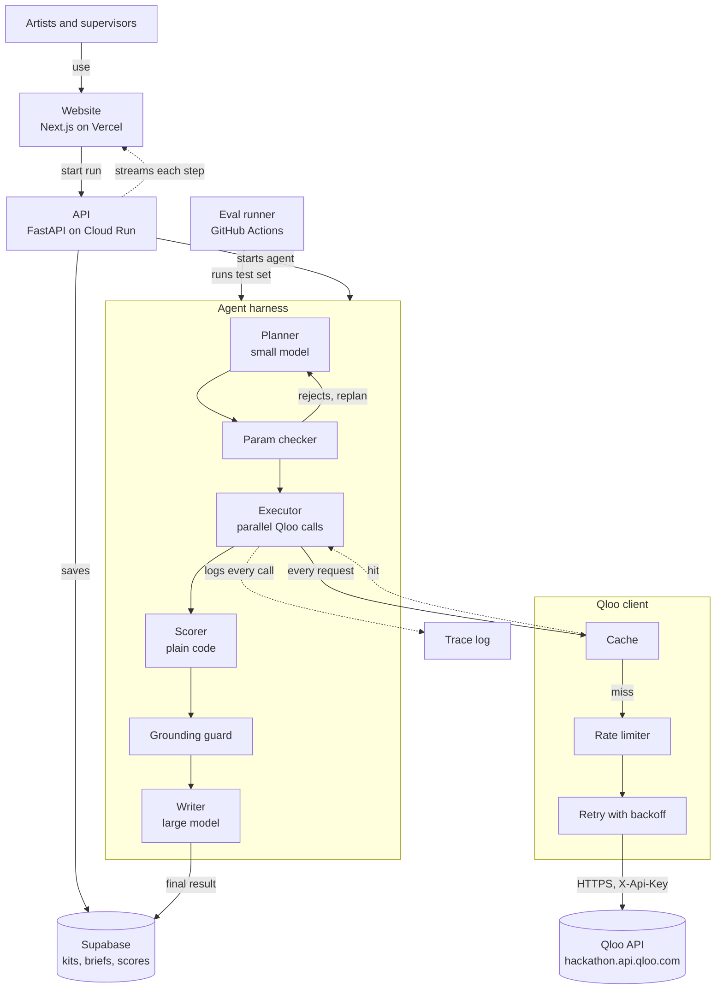
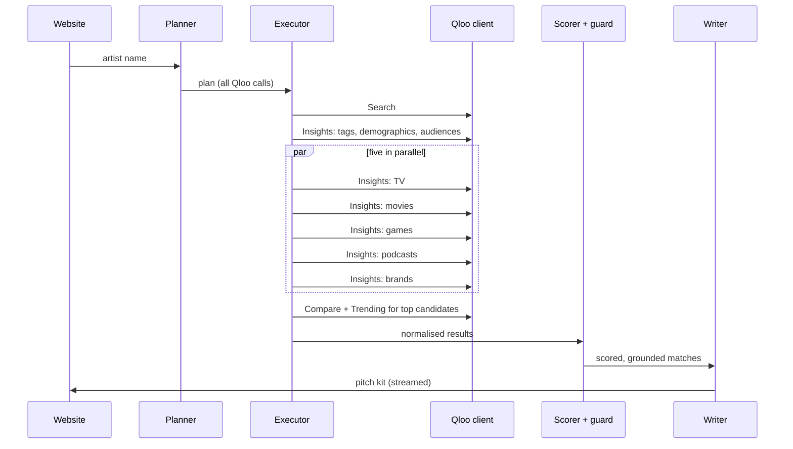

# Cue — Design

How Cue is built and why. Requirements live in [PRD.md](PRD.md); rules every session must follow
live in [CLAUDE.md](CLAUDE.md).

## 1. System



The LLM plans and writes. Qloo supplies the facts. Plain code checks and scores. Every Qloo request
goes through one client, and only a cache miss reaches the API.

## 2. One run, both modes

| Step | Artist mode | Supervisor mode | Qloo endpoints |
|---|---|---|---|
| 1 Find | Find the artist; fall back to sounds-like artists | Find the show, film, game or brand | Search, Entities by ID |
| 2 Profile | Fan taste tags, age and gender lean, audiences | Audience taste tags, age and gender lean, audiences | Insights (tags), Tags, Tag types, Audiences, Audience types |
| 3 Match | Insights for TV, movies, games, podcasts, brands, in parallel | Insights for artists with `filter.popularity.max` | Insights |
| 4 Check | Compare artist vs each top production; trending shows | Compare production vs each top artist; trending artists | Compare, Trending |
| 5 Score and write | Fit score in code; pitch kit per production | Same fit score; shortlist brief | — |
| Extra | Where fans cluster, for local ad and radio pitches | Where the show's audience clusters | Insights (heatmap) |



## 3. Using Qloo

**Base URL:** `https://hackathon.api.qloo.com`. Hackathon keys fail against staging and production
with a 401. Key goes in the `X-Api-Key` header. Insights is a GET with parameters in the query
string.

**Entity types for `filter.type`:** artist, book, brand, locality, movie, person, place, podcast,
tv_show, videogame (as `urn:entity:<type>`). Music is `urn:entity:artist`. Games are
`urn:entity:videogame`; `urn:entity:video_game` returns a 400. The hackathon guide also lists
`destination`; it is untested, and the API reference uses `locality`.

Special `filter.type` values on `/v2/insights`: `urn:demographics` (age and gender lean),
`urn:heatmap` (where an audience clusters) and `urn:tag` (taste tags for an audience).

**Endpoints we use** (all checked against the live API on 21 Oct 2026):

| Endpoint | Our tool | Used for |
|---|---|---|
| `/search` | `find_entity` | Name to Qloo ID; grounding guard; made-up-name check in eval |
| `/entities?entity_ids=` | `get_entities` | Details for the report; ID check in the guard |
| `/v2/tags?filter.query=` | `find_tags` | Words like "dream pop" to tag IDs |
| `/v2/tags/types` | `get_tag_types` | Grouping the taste profile |
| `/v2/audiences?filter.query=` | `find_audiences` | Audience groups for the profile and as signals |
| `/v2/audiences/types` | `get_audience_types` | Listing audience kinds |
| `/v2/insights` | `insights` | Profiles, matches, demographics, heatmap |
| `/v2/analysis/compare` | `compare` | Artist vs production fit |
| `/v2/trending` | `trending` | Whether a candidate is rising |

Don't use `/recommendations` or `/recs`; they are legacy and unsupported.

**Parameters we lean on:**

- Signals: `signal.interests.entities`, `signal.interests.tags`, `signal.demographics.age`,
  `signal.demographics.gender`, `signal.demographics.audiences`, `bias.trends`
- Filters: `filter.type`, `filter.popularity.max`, `filter.results.entities`,
  `filter.exclude.entities`, `filter.tags`, `filter.release_year.min` (movies),
  `filter.latest_known_year.min` (TV, keeps results to shows still running)
- Output: `feature.explainability`, `take` (max 50), `page`, `sort_by`, `diversify.by`,
  `output.heatmap.boundary`

**Quirk that shapes the design:** invalid parameters for a `filter.type` are silently ignored.
A request can look fine and return the wrong thing. That is why the param checker exists (§4).

### What the live API actually returns

Checked on 21 Oct 2026 with real calls. Build WU-01 against these, not against the doc prose.

- **Entity shape.** `types` is a list (read `types[0]`). `popularity` is top level, 0–1. On
  Insights results, `affinity` is at `query.affinity` and the explanation at
  `query.explainability`.
- **Explainability.** `query.explainability["signal.interests.entities"]` is a list of
  `{entity_id, score}`, one per input entity. With three sounds-like artists as the signal, each
  gets its own share, so every match can say which input drove it.
- **Extra artist data.** `properties.external` carries `lastfm.listeners` and `lastfm.scrobbles`
  (real fan counts), plus Spotify, MusicBrainz and Wikidata IDs. Artist tags include audience
  traits such as `urn:tag:audience:qloo:loyal` and `:passionate`.
- **Search returns wrong top hits.** When the exact name isn't in Qloo, `/search` still returns
  its nearest fuzzy match first ("Aditi Ramesh" → "Ramesh"). `find_entity` must check the name
  matches and return not found otherwise, never take the first hit blindly.
- **Games skew to blockbusters.** Without a cap, game affinities return the most popular titles
  for almost any artist. Use `filter.popularity.max` (about 0.9) for games.
- **Duplicate titles.** The same title can appear twice with different entity IDs (seasons or
  versions). De-duplicate by normalised title and keep every ID for the grounding guard.
- **Compare** takes `a.signal.interests.entities` and `b.signal.interests.entities` and returns
  the shared tags, each with `query.score` (0–1). There is no single overlap number; WU-01 decides
  how to turn the tag scores into `overlap` and logs it here.
- **Trending is per entity, not a list.** `/v2/trending` requires `signal.interests.entities`,
  `filter.start_date` and `filter.end_date`, and returns a weekly series for that entity
  (`population_percentile`, `population_rank`, `population_rank_velocity`,
  `velocity_fold_change`). **The hackathon data ends around 30 Jul 2026**, so a window ending after
  that comes back empty. Query the 12 weeks up to the latest available week. The `trending` tool
  in §7.1 takes one entity and returns this series with its as-of date.
- **Demographics** returns `results.demographics[0].query.age` (six buckets, `24_and_younger` to
  `55_and_older`) and `.gender` (`male`, `female`), each from −1 to 1.
- **Heatmap** returns `results.heatmap[]`, each with `location` (lat, lon, geohash) and `query`
  (`affinity`, `affinity_rank`, `popularity`).

## 4. Harness

- **Planner** (Claude Haiku 5.5, effort `low`, structured output): reads the input and returns the
  full list of Qloo calls for the run, with dependencies. Doing this once lets independent calls run
  at the same time.
- **Param checker** (`cue/qloo/params.py`): a table of which parameters each `filter.type` accepts,
  copied from Qloo's Entity Type Parameter Guide. Any call with an unsupported parameter is rejected
  and sent back to the planner with the reason. Max two replans.
- **Executor:** runs calls as `asyncio` tasks in dependency order; independent calls run in
  parallel. Per-call timeout 10 s. Max 40 Qloo calls per run.
- **Scorer:** see §6.
- **Grounding guard:** see §5.
- **Writer** (Claude Opus 5.5, structured output): turns scored, grounded matches into a pitch kit or
  brief. Gets only our checked data, never raw text from elsewhere.
- **Run events:** every step and Qloo call emits an event (§7.3), streamed to the website over
  server-sent events and stored with the run.

## 5. Guardrails and caching

**Guardrails**

| Guard | Where | What it stops |
|---|---|---|
| Param checker | Before every Qloo call | Requests Qloo would silently ignore |
| Grounding guard | After the writer | Any name not matching a Qloo ID from this run |
| Pitch-claim guard | After the writer | "Your song was featured in…" without data showing it |
| Score lock | Writer output schema | The model can't output a score; scores are joined in by code |
| Input handling | Planner and writer | Artist names and briefs are data in a delimited field, never instructions |
| Popularity cap | Supervisor mode | Famous artists labelled as emerging |

**Caching** (private, server-side only; Qloo allows this with no time limit)

| What | Key | Keep for |
|---|---|---|
| Name to Qloo ID | normalised name + type | 30 days |
| Qloo responses | endpoint + sorted, normalised params | 24 hours |
| Planner output | input + `PROMPT_VERSION` | 24 hours |
| Writer output | scored matches hash + `PROMPT_VERSION` | 24 hours |

Never cache fit scores; recompute them from cached inputs so a scorer change takes effect at once.
Start with an in-memory cache behind the `Cache` interface; switch to Redis (Upstash) for deploy.

**Rate limiting and retries:** token bucket in the Qloo client sized below our key's limit; retry
429 and 5xx up to 3 times with jittered backoff; a 4xx other than 429 is not retried.

**Speed**

- Plan once, run in parallel
- Small model for planning, large model only for writing
- Stream results as they arrive
- Provider-side prompt caching for the fixed instructions and tool definitions
- Pre-warm the demo artists and shows before judging

## 6. Fit score

Plain code in `cue/scoring/fit.py`. Inputs are normalised to 0–1 by the Qloo tools:

| Input | From |
|---|---|
| `affinity` | Insights result's affinity for the candidate |
| `overlap` | Compare result between the two entities |
| `trend` | The candidate's latest week from `trending`, scaled to 0–1 (0 if no data) |
| `audience` | How closely the candidate's age and gender lean matches the source's |

```
fit = 0.50 * affinity + 0.30 * overlap + 0.10 * audience + 0.10 * trend
```

- Missing `affinity` or `overlap` gives `insufficient_data`, not a number
- Weights are a starting point, tuned only on the eval's dev split, never on the test split
- Which Qloo response fields feed each input is settled in WU-01 and logged in VERSION.md
- `trend` is only as recent as Qloo's data, which ends about 30 Jul 2026. Every place that shows
  it, in the UI, the pitch kit and the brief, labels it "as of July 2026", never as current

## 7. The agreed contract

Changing anything here is a MAJOR change: agree in chat first, own PR, VERSION.md entry.

### 7.1 Qloo tools

```python
async def find_entity(name: str, types: list[str]) -> list[EntityRef]
async def get_entities(ids: list[str]) -> list[Entity]
async def find_tags(query: str, tag_types: list[str] | None = None) -> list[TagRef]
async def get_tag_types() -> list[str]
async def find_audiences(query: str | None = None, audience_types: list[str] | None = None) -> list[AudienceRef]
async def get_audience_types() -> list[str]
async def insights(request: InsightsRequest) -> InsightsResult
async def compare(a_ids: list[str], b_ids: list[str]) -> CompareResult
async def trending(entity_id: str, entity_type: str) -> TrendSeries
```

### 7.2 Records

```python
EntityRef      id, name, type, popularity
Match          source_id, candidate: EntityRef, affinity, overlap, audience, trend, trend_as_of: date | None, explanation
TrendSeries    entity_id, as_of: date | None, weeks: list[TrendWeek]
TrendWeek      week_start: date, percentile, rank, rank_velocity, velocity_fold_change
FitScore       match_id, value: float | None, status: "ok" | "insufficient_data", inputs: dict
PitchKit       run_id, artist_id, items: list[PitchItem]
PitchItem      candidate: EntityRef, fit: FitScore, reason: str, email_subject: str, email_body: str
Brief          run_id, production_id, artists: list[BriefItem]
BriefItem      candidate: EntityRef, fit: FitScore, reason: str
```

### 7.3 Run events (streamed to the website)

```json
{"run_id": "r_123", "seq": 7, "kind": "qloo_call", "endpoint": "/v2/insights",
 "params": {"filter.type": "urn:entity:tv_show", "signal.interests.entities": "..."},
 "ms": 412, "cache": "miss", "status": "ok", "result_count": 20}
```

`kind` is one of `step_start`, `step_end`, `qloo_call`, `guard_drop`, `result`, `error`.

### 7.4 Eval record

```json
{"id": "p_042", "split": "test", "mode": "supervisor", "input": "Show name",
 "answer": "Artist name", "source": "where we learned this placement"}
```

No Qloo responses in eval files. Ever.

## 8. Evaluation

**Systems:** A = LLM alone, B = LLM with web search, C = Cue. Same test set, same scorers.

**Test set:** about 300 known real placements (artist used in show), split 60 dev / 240 test.
Curated by hand or from sources whose terms allow it (PRD Q-4).

**Scorers**

| Metric | How |
|---|---|
| Hit rate in top 10 | Is the known answer in the system's top 10? Both directions |
| Made-up names | Share of suggested names that don't resolve via Qloo Search |
| Emerging share | Share of suggested artists under the popularity cap |
| Consistency | Overlap of top 10 across three runs of the same input |
| Time and cost | Per run, median and slowest |

**Runs:** a 30-sample smoke eval on every push (GitHub Actions); the full set on demand. Results
feed the eval page as JSON with our scores only.

## 9. Deployment and observability

- Website on Vercel; API on Cloud Run (stateless, min 1 instance during judging so there's no cold
  start); Supabase for storage; Upstash Redis for cache
- Secrets in Secret Manager; `.env` locally
- Every run stores its events; the trace panel reads them live
- `DEMO_MODE=true` serves every Qloo and model call from cache with zero external calls
